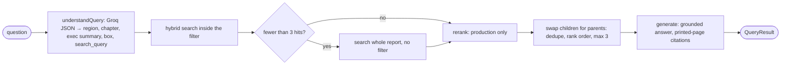

# UC2 — Global Economic Prospects, June 2026 (long, structured)

`data/raw/GEP-Jun-2026.pdf` · 200 pages · pipeline: extraction + repair → **structure from fonts** → hierarchy → vision table chunks → hybrid inside filters → rerank (production only) → **swap children for parents** → grounded answer.

> Status of numbers: _measured offline_ = `npm run offline:bm25`, `verify:gold`, `npm test`; _measured with the APIs_ = `uc2:eval` and `uc2:eval -- --ladder` in development mode. Open item: the **production run with rerank**.

## 1. What breaks

| Failure                                                       | Real example                                                                                                                                                                                                                                                                                                                         |
| ------------------------------------------------------------- | ------------------------------------------------------------------------------------------------------------------------------------------------------------------------------------------------------------------------------------------------------------------------------------------------------------------------------------ |
| **Damaged text: the “Th” ligature is dropped.**               | `Te global economy is facing another major shock. Te conflict in the Middle East…` (Executive Summary, PDF 19). **about 300 occurrences** of words like `Te`, `Tis`, `Tey`, `Tese` in the raw text. Neither dense nor BM25 matches “The/This” to them; the stop-word “the” is missing from the index. `fl`/`fi` ligatures also appear. |
| **No knowledge of chapter/region.**                           | `Growth in SAR is expected to soften to 6.3 percent in 2026…` (PDF 96) never says “South Asia” in that sentence; the chunk has no idea it is in Chapter 2, region South Asia, section Outlook. The string `6.3 percent` also appears on PDF 50, 76 and 78 in other contexts.                                                         |
| **Passages say “SAR”, questions say “South Asia”.**           | Question: _what is the outlook for SSA?_ — the report writes “Growth in SSA is forecast to edge down to 4 percent in 2026…” under the heading “Sub-Saharan Africa”. Acronym/region/country (“India”, “Brazil”, “Pakistan”) must be mapped to the region heading.                                                                     |
| **Six regions all discuss “growth forecasts”.**               | Every regional section has Recent developments / Outlook / Risks with near-identical vocabulary; without a region filter the top-5 mixes regions. `1.6 percent` appears on PDF 47, 72, 92, 100, 154 — only PDF 92 is the Middle East, North Africa, Afghanistan, and Pakistan answer.                                                |
| **Small chunks lack context; table fragments outrank prose.** | 280-token children are searchable but too short to answer from; the forecast tables extract as `World 2.8 2.9 2.9 2.5 2.8 2.8 -0.1 0.1 Advanced economies 1.6 1.8…` (PDF 26) — a row-less bag of numbers that matches almost any numeric query. In this file **3,394** text-layer fragments are small-font (< 9.2 pt).               |

## 2. Document anatomy

### Typography (inspected first, from real spans)

| Role            | Font                             | Size                                                      | Example                                                                            |
| --------------- | -------------------------------- | --------------------------------------------------------- | ---------------------------------------------------------------------------------- |
| body            | `AGaramondPro-Regular`           | **11 pt** (**10.6 pt inside boxes**)                      | `The disruptions to commodity markets…`                                            |
| box body        | `AGaramondPro-Regular/Italic`    | 10.6 pt                                                   | pp. 30–35, 44–50, 76–80, 116–120                                                   |
| section heading | `HelveticaLTStd-Bold`            | 16 pt (14 pt for the Chapter 2 overview and “References”) | `South Asia`, `Global context`                                                     |
| subsection      | `HelveticaLTStd-Roman`           | 11 pt, < 90 chars, no final “.”                           | `Recent developments`, `Outlook`                                                   |
| caption         | `HelveticaLTStd-Bold`            | ~10 pt                                                    | `BOX 1.1 How much will AI …`, `TABLE 2.10 South Asia …`, `FIGURE 2.7 SAR: Outlook` |
| small           | Helvetica Roman/Oblique/Light    | 5.7–7.6 pt                                                | chart labels, table cells, source notes, footnotes                                 |
| page titles     | `HelveticaLTStd-Cond` / Garamond | 26–30 pt                                                  | `Executive Summary`, `CHAPTER 2` + `REGIONAL OUTLOOKS` dividers                    |
| running header  | `HelveticaLTStd-Light` 7 pt      | `CHAPTER 2` + `GLOBAL ECONOMIC PROSPECTS                  | JUNE 2026`, bold 8 pt page number in a corner                                      |

### Layout and numbering

Two columns on text pages (left x≈89, right x≈323 on a 612 pt page), full-width tables and figures. Printed page numbers: front matter roman (PDF 19–20 = xvii–xviii); **from Chapter 1 PDF = printed + 22** (PDF 96 = 74, PDF 187 = 165). Chapter dividers: PDF 23, 69, 107, 143, 185.

Chapters (from the `CHAPTER n` running header): Ch. 1 PDF 25–68, Ch. 2 PDF 71–105 (overview 71–80, regions EAP 81, ECA 84, LAC 88, MNA 92, SAR 96, SSA 99, References 103), Ch. 3 PDF 109–142, Ch. 4 PDF 145–183; statistical appendix 187–191; selected topics 192–200.

### Element types and damage

Prose, boxes (BOX 1.1, 1.2, 2.1, 3.1 …), figure blocks (chart labels + title + summary + source), forecast tables, reference lists, annexes. Damage: dropped “Th” ligature, `fl`, hyphenation across lines (`deteriora- tion`), footnote markers after figure/table titles (`Real GDP [^1]`).

## 3. Assumptions

| Assumption                                                                                                                                                                                                                          | How it could break                                                                                                                |
| ----------------------------------------------------------------------------------------------------------------------------------------------------------------------------------------------------------------------------------- | --------------------------------------------------------------------------------------------------------------------------------- |
| Body is Garamond ≥ 9.2 pt, headings are Helvetica, **section = bold Helvetica ≥ 14 pt**, subsection = regular Helvetica 10–12.5 pt < 90 chars not ending with “.”, small = < 9.2 pt (`structure.ts` `TYPO`)                         | another edition with different fonts; a regular-Helvetica body sentence under 90 chars without a full stop would become a heading |
| A box is 10.6 pt body text after a `BOX n.m` caption; the box ends when 11 pt body text returns or a section heading appears                                                                                                        | a box set at 11 pt would swallow following text                                                                                   |
| Chapter = the `CHAPTER n` running header (or divider); region = last bold Helvetica heading in Chapter 2 whose text equals one of the six names                                                                                     | heading renamed or wrapped differently (two-line headings are joined: `Latin America and` + `the Caribbean`)                      |
| Table pages inherit the region active at the **end** of the page                                                                                                                                                                    | a table page that also starts a new region                                                                                        |
| Text that is not Garamond-sized (< 9.2 pt) is noise, not content                                                                                                                                                                    | small-font prose (none found in the body)                                                                                         |
| Th repair: `Te/Tis/Tey/Tere/Tese/Tose/Tus/Tird…` are never real words and are always repaired at word boundaries; `Ten`, `Tan`, `Tree`, `Tough`, `Trough` are repaired only in a context that says _Then/Than/Three/Though/Through_ | a proper noun spelled like a damaged word (`Teo…` appears in references and is left alone)                                        |
| Page offsets (+22)                                                                                                                                                                                                                  | inserting pages                                                                                                                   |
| Chapter is filtered only when the question literally says “Chapter N”                                                                                                                                                               | a question that means a chapter without saying so is simply searched globally (by design)                                         |

## 4. Techniques

| Problem                     | Fix                                                                                                                                                                                                                                              | Why it works                                                                                                 | Rejected                                      | Cost                                       |
| --------------------------- | ------------------------------------------------------------------------------------------------------------------------------------------------------------------------------------------------------------------------------------------------ | ------------------------------------------------------------------------------------------------------------ | --------------------------------------------- | ------------------------------------------ |
| damaged text                | NFKC + `Th` word map + hyphen joins **before chunking**                                                                                                                                                                                          | the index now contains “The”, “This”, “They”                                                                 | fixing it at query time; an LLM clean-up pass | CPU only                                   |
| no structure                | **structure from fonts**: caption/section/subsection/small/body → chapter, region, box, kind, heading path (`Chapter 2: Regional Outlooks > South Asia > Outlook`)                                                                               | the document’s own typography is a free, exact outline                                                       | LLM-generated outlines                        | CPU only                                   |
| small chunks lack context   | **hierarchy**: children ~280 tokens (40 overlap) are searched; parents ~900-token sentence windows inside one section are read; parent swap dedupes by parent, keeps rank order, max 3                                                           | precision of small chunks, context of large ones                                                             | one chunk size                                | 372 children + 148 parents here            |
| passages lack their heading | embed `headingPath + "\n" + text` (stored text unchanged)                                                                                                                                                                                        | the vector and BM25 index “know” chapter/region/section                                                      | storing the prefix in the text                | +~20 tokens per chunk                      |
| region ambiguity            | **routing**: one Groq call (Zod JSON) → region/chapter/exec-summary/box filter + rewritten query; rules router (regex aliases) as the baseline; filter applied to Chroma and MiniSearch identically; fewer than 3 hits → search the whole report | a wrong filter hides the answer, so chapter is set **only** on a literal “Chapter N” and the fallback exists | inferring chapter from topic                  | 1 `gpt-oss-20b` call (cached per question) |
| table fragments             | **vision table chunks** (11 listed pages) become `kind: "table"` row-per-line chunks with the region/chapter of their page; text-layer fragments are noise kinds, **never indexed**                                                              | clean `Row                                                                                                   | column: value`text replaces`2.8 2.9 2.9 2.5…` | indexing fragments with a penalty          | 11 Gemini calls once |
| ranking                     | rerank in production                                                                                                                                                                                                                             | cross-encoder                                                                                                | local model                                   | per uncached query                         |

## 5. Vision pages (`usecases/uc2-gep/vision-pages.json`)

Tier 1 (enabled, `saveAsset: false`): **26** (Table 1.1 global forecasts), **83** (EAP summary + country tables), **86, 87** (ECA), **90, 91** (LAC), **94, 95** (MNA), **98** (Table 2.10 South Asia incl. India fiscal years), **101, 102** (SSA). Why: in the naive run table fragments outranked the outlook sentence and produced a confident wrong answer.

Tier 2 (not enabled; list in the README): figure pages whose title, summary and source notes are already in the text layer; no eval question depends on chart values. Skipped on purpose: cover, chapter dividers, front-matter photos and foreword (3–21 except the Executive Summary on 19–20), Table 1.2 (62), regression/data tables (134–138), selected topics (192–200).

## 6. Pipeline walkthrough

| Step            | Real sample                                                                                                                                                                                                           | File                                |
| --------------- | --------------------------------------------------------------------------------------------------------------------------------------------------------------------------------------------------------------------- | ----------------------------------- |
| extract + order | PDF 96 → left column (Recent developments) then right column (Outlook), header `GLOBAL ECONOMIC PROSPECTS                                                                                                             | JUNE 2026`removed, printed page`74` | `pdf/layout.ts` |
| repair          | `Te global economy is facing…` → `The global economy is facing…`                                                                                                                                                      | `pdf/repair.ts`                     |
| classify        | `South Asia` 16 pt bold Helvetica → section (region); `Outlook` Helvetica 11 → subsection; body Garamond 11 → body                                                                                                    | `structure.ts`                      |
| hierarchy       | section `South Asia > Outlook` → parent `uc2-s52-p0` (~514 tokens) → children `…-c0..c3`                                                                                                                              | `chunking/hierarchy.ts`             |
| child sample    | id `uc2-s52-p0-c0`, PDF 96, printed 74, region South Asia, chapter 2, heading `Chapter 2: Regional Outlooks > South Asia > Outlook`: `Growth in SAR is expected to soften to 6.3 percent in 2026, mainly reflecting…` |                                     |
| noise           | 1,244 reference units, 446 front-matter, 3,394 table fragments excluded                                                                                                                                               | `buildNoiseSummary`                 |
| vision          | PDF 98 → `kind: "table"`, heading `Chapter 2: Regional Outlooks > South Asia > Table 2.9, Table 2.10`, region South Asia                                                                                              | `usecase/vision-chunks.ts`          |

Counts: 705 naive chunks · 372 children · 148 parents (children avg ≈ 216 tokens, parents ≈ 514; 80.7k child tokens) · 11 table chunks.

## 7. Query graph

`understandQuery` writes `Query: LLM read the question: region=South Asia`; the guard rails in code drop a region that is not in the list, drop a chapter the question did not literally name, and fall back to the original question if the rewrite is empty. Noise kinds are always excluded by the filter. `search` writes `Retrieve: Hybrid search over N heading-tagged chunks inside the filter: shortlist of K` (and a second line if it fell back). `parents` writes `Swapped for 2 parent sections`. The rules router (`regions.ts`) is the same interface, used by the ladder.

## 8. Ablation ladder results

Ladder: **1** naive 1000-char → **2** section-aware chunks → **3** + heading path embedded → **4** + hybrid → **5** + routing (rules) → **5′** routing (LLM) → **6** + parents → **7** + vision table chunks → **8** + rerank (production/`--rerank`, else “skipped”). Steps 6–8 score larger units (≤ 3 parent sections), so they are not directly comparable with steps 1–5.

_Measured offline, BM25 only, 7 scored questions (`npm run offline:bm25`):_

| Step | Technique (BM25 only)                 | hit@1 | hit@3 | hit@5 | MRR  |
| ---- | ------------------------------------- | ----- | ----- | ----- | ---- |
| 1    | naive 1000-char                       | 0.29  | 0.43  | 0.57  | 0.39 |
| 2    | section-aware children, text only     | 0.43  | 0.43  | 0.43  | 0.43 |
| 3    | + heading path in the index text      | 0.29  | 0.71  | 0.71  | 0.48 |
| 5    | + routing (rules) with fallback       | 0.86  | 0.86  | 1.00  | 0.89 |
| 6    | + parents (scored on parent sections) | 0.86  | 1.00  | 1.00  | 0.93 |

Reading it: routing is the big jump (MRR 0.48 → 0.89) because the region filter removes the other five regions; heading path helps recall (hit@3 0.43 → 0.71) but not hit@1 with BM25 alone (n = 7: noise-level). Repairing “Te/Tis” text and sentence-aligned children already lifts step 1 → 2 on hit@1. Steps 4, 5′, 7, 8 need Voyage/Groq/Gemini.

_Measured with the APIs (7 scored questions, `npm run uc2:eval -- --ladder`, development mode):_

| Step | Technique                                       | hit@1 | hit@3 | hit@5 | MRR  | production run with rerank |
| ---- | ----------------------------------------------- | ----- | ----- | ----- | ---- | -------------------------- |
| 1    | naive 1000-char, dense                          | 0.29  | 0.86  | 0.86  | 0.55 |                            |
| 2    | section-aware, dense                            | 0.43  | 0.86  | 1.00  | 0.62 |                            |
| 3    | + heading path embedded                         | 0.57  | 0.86  | 0.86  | 0.69 |                            |
| 4    | + hybrid                                        | 0.57  | 0.71  | 1.00  | 0.71 |                            |
| 5    | + routing (rules)                               | 0.86  | 0.86  | 1.00  | 0.89 |                            |
| 5′   | + routing (LLM)                                 | 0.71  | 1.00  | 1.00  | 0.83 |                            |
| 6    | + parents (scored on parents)                   | 0.86  | 1.00  | 1.00  | 0.93 |                            |
| 7    | + vision tables (parents)                       | 0.86  | 1.00  | 1.00  | 0.93 |                            |
| 8    | + rerank (Voyage `rerank-2.5-lite`, `--rerank`) | 0.86  | 1.00  | 1.00  | 0.93 | measured, retrieval only   |

**Step 8 (rerank) equals step 7** (hit@1 0.86, MRR 0.93): with 7 questions the gold passage is already in the top 5 and rank 1 for six of them, so rerank has nothing to improve here; only 5′ → 6 (parents) moves the metric. The first rerank attempt fell back to the plain order for 2 of 8 questions (429s, requests over the free-tier token limit); `rerank()` now sends only the best candidates that fit the budget. **Rerank-on answers, now measured** (`reports/uc2-2026-10-26T07-33-12-ladder-rerank.md`): **6/7**, down from 7/7 — see the table below. Retrieval still finds the gold passage (rank 1), so again this is a **generation-side** regression, not a retrieval one.

Steps 6–8 score ≤ 3 parent sections, not single chunks: not directly comparable with 1–5.

What earned its place on this document: **routing** is the big step (MRR 0.71 → 0.89 with rules, 0.83 with the LLM); the heading path and sentence-aligned repaired chunks give steady gains from step 1 to 3 (0.55 → 0.69); **parents** lift hit@1 of the LLM-routed run from 0.71 to 0.86 and MRR to 0.93. **Hybrid alone did not help** (0.69 → 0.71, hit@3 fell 0.86 → 0.71): same pattern as the UC1 reference. **Rules routing beat LLM routing on hit@1** (0.86 vs 0.71 before parents): the rules know the country lists exactly, the LLM sometimes rewrites the query (e.g. B1 hit rank 3). With n = 7, differences under ~0.1 are noise and 0.86 vs 0.71 is a single question. Vision tables (step 7) did not change the metric because the gold sentences for the eval questions are in prose; the table chunks matter for table-only questions (the naive run's table-fragment problem). The measured naive-index **answers** show the user-visible failures the metrics hide: B2 (Chapter 3) and S1 (region with Pakistan) were refused with “I could not find this in the document.” (`reports/uc2-2026-10-21T06-56-27-naive.md`), both answered correctly on the final pipeline.

### Answer accuracy (automatic checks)

| Run                                                              | checks passed | detail                                                                                               |
| ---------------------------------------------------------------- | ------------- | ---------------------------------------------------------------------------------------------------- |
| naive index (prompt v2)                                          | 5/7           | B2 (Chapter 3) and S1 (region with Pakistan) were refused: _I could not find this in the document._  |
| final pipeline (prompt v3, `reports/uc2-2026-10-22T09-05-27.md`) | **7/7**       | every answer contains the expected figures; hit@1 0.71 → 0.86 after the parent swap, MRR 0.83 → 0.93 |
| final pipeline + production rerank (`--rerank --ladder`, `reports/uc2-2026-10-26T07-33-12-ladder-rerank.md`) | **6/7** (regression) | B2 _FAIL_: answer gives “median EMDE debt increased by 20 percentage points of GDP between 2010 and 2024 … 114 basis points … 31 basis points” instead of the chapter's headline stat (40% → 70% of GDP, 6% → 11% of revenues, verified below). The retrieved chunk (rank 1, same page 109 paragraph) contains both the headline sentence and the 149bps/40bps figures the model actually cites — rerank changed which secondary passages sit alongside it, and the model reached for the wrong one. All other answers unchanged. |

**B2 verification (the open item from the first run):** the figures in the answer were checked against the text on PDF 109: “Aggregate government debt in EMDEs has increased from less than 40 percent of GDP in 2010 to over 70 percent … the cost of servicing government debt has risen, from 6 percent of government revenues in 2010 to an estimated 11 percent in 2025.” The answer’s 40% → 70% and 6% → 11% are exact — this is the no-rerank run's answer; the rerank-on run (row above) misses it.

## 9. Eval results

Gold pages are 1-based PDF pages, confirmed with `npm run verify:gold`:

| id  | Question                          | Spec gold        | **Verified gold (PDF)** | Evidence      | Note                                                                |
| --- | --------------------------------- | ---------------- | ----------------------- | ------------- | ------------------------------------------------------------------- |
| B1  | growth outlook for South Asia     | 96               | **96**                  | `6.3 percent` | also on PDF 50, 76, 78 in other contexts                            |
| B2  | Chapter 3 on sovereign debt       | 109–111 (verify) | **109, 110, 111**       | —             | Chapter 3 introduction; divider is 107                              |
| B3  | executive summary risks           | 19–20            | **19, 20**              | —             | printed xvii–xviii                                                  |
| S1  | 2026 growth, region with Pakistan | 92–93            | **92**                  | `1.6 percent` | PDF 93 has no “1.6 percent”; 47, 72, 100, 154 are other contexts    |
| S2  | India FY2026/27                   | 96–98 (verify)   | **96, 98**              | —             | text on 96 (“6.6 percent in fiscal year 2026/27”), Table 2.10 on 98 |
| S3  | Brazil                            | 88–89 (verify)   | **88, 89**              | `Brazil`      | 90–91 are the forecast tables, 74 the chapter overview              |
| S4  | outlook for SSA                   | 100–101 (verify) | **99, 100**             | —             | SSA Outlook text is on 99–100, **not 101** (101 is the table page)  |
| R1  | June 2030 edition                 | —                | —                       | —             | exact refusal phrase                                                |

Measured (final pipeline, development mode, `reports/uc2-2026-10-19T14-06-32.md`): before parent swap hit@1 0.71, hit@3 1.00, hit@5 1.00, MRR 0.83; **after the parent swap** 0.86 / 1.00 / 1.00 / 0.93; refusal exact. Answers (checked against the text): B1 6.3 percent in 2026 ✔ (adds 7 percent per year in 2027–28 ✔); B2 debt up from < 40% to > 70% of GDP, debt-service costs 6% → 11% of revenues ✔ plausible, please verify; B3 risks listed ✔; S1 1.6 percent ✔; S2 6.6 percent ✔; S3 Brazil 1.9 percent in 2026, 2.1 percent 2027–28 ✔; S4 4 percent in 2026, 4.4 percent 2027–28 ✔; R1 exact refusal ✔. Router: LLM set the right region/chapter/exec-summary filter in every case.

| id  | Verdict (yours) | Notes |
| --- | --------------- | ----- |
| B1  |                 |       |
| B2  |                 |       |
| B3  |                 |       |
| S1  |                 |       |
| S2  |                 |       |
| S3  |                 |       |
| S4  |                 |       |
| R1  |                 |       |

## 10. Cost and usage

Expected: Gemini Flash-Lite 11 page images once; Voyage embeddings ≈ 350k tokens for naive (≈ 176k), section-aware (≈ 80k), heading-tagged (≈ 88k) and tables (≈ 5k) — ≈ 35 minutes at `VOYAGE_TPM=10000`, free on re-run; Groq: 1 routing call (cached) + 1 answer call per question; rerank (production) ≈ 40 candidates × ~220 tokens per uncached query. **Escalation: none made.** Record any `gpt-oss-120b` use here with the failing question and both answers.

## 11. Failure modes and limits

- All thresholds are tuned to this edition’s fonts (§3); a different report needs re-inspection, not a different algorithm.
- Boxes are bounded by font size and may include one or two paragraphs after the true end when the box and the next section share 10.6 pt text.
- Region for a table page is “region at the end of the page”.
- Routing by LLM can still be wrong (e.g. multi-region questions): the rule “null when unsure” and the < 3 hits fallback bound the damage; a wrong region with ≥ 3 hits would hide the answer.
- Vision tables are model transcriptions; the original page is not saved for Tier 1 (`saveAsset: false`).
- The Th map covers the words found in this PDF; new damaged words need a map entry.

## 12. Try next

Multi-query (one per region) for multi-region questions; HyDE; decomposition (“compare South Asia and Sub-Saharan Africa”); corrective-RAG loop when routing yields no hits; `voyage-context-4`; **GEP Tier 2 vision pages** for chart-value questions and website images; reranker experiment `rerank-2.5`; compare `RRF_K=60` against 2.
